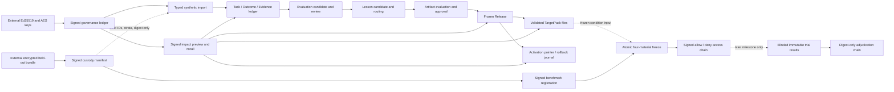

# Architecture

Status: **Milestone 3 implemented; local, file-only, encrypted custody, and synthetic-only**

## 1. System shape

The system is an offline, subject-scoped adaptation compiler. It turns explicitly imported,
typed records into review-gated portable artifacts, immutable releases, and inspected target files.
It does not invoke a source or target agent. The Codex and Claude Code renderers only write
external files according to a declared capability profile.



The dotted edges mark deliberately constrained information flow. Construction receives only
payload-free blinded split metadata, and the dormant trial-result path cannot retrieve held-out
plaintext. Benchmark results and adjudications never alter the release they evaluate.

Milestone 3 does not connect this graph to Codex or Claude Code. The governance CLI signs only
synthetic selectors, capture previews, and local recall operations; no source enumeration or raw
user capture is reachable. Custody and benchmark registration are library APIs covered by
synthetic tests, not operator commands for revealing or executing a study.

## 2. Records and relationships

`TaskRecord`, `Outcome`, `Evidence`, `EvaluationCase`, `LessonCandidate`, `Artifact`, `Release`,
and `TargetPack` are the canonical top-level records. Their responsibilities are defined in
[`MVP_SPEC.md`](MVP_SPEC.md#2-domain-contract); each has a stable ID, version, canonical digest,
scope, privacy metadata, and exact references.

The accepted lineage is a directed acyclic graph:

```text
TaskRecord --> Outcome --> EvaluationCase
     |             |              |
     +-----------> Evidence --> LessonCandidate --> Artifact --> Release --> TargetPack
```

Evidence may support, contradict, or limit a claim. An `Artifact` retains direct evidence links
even when it also references a lesson. A `Release` holds exact approved artifact versions, while a
`TargetPack` is a derived rendering and never the canonical learned asset.

Fourteen signed governance objects sit beside, rather than inside, the eight-record portable
contract. The first eight govern identity, evidence admission, lifecycle, and recall:

| Object | Responsibility | Binding |
| --- | --- | --- |
| `SignerIdentity` | Self-signed public identity and role/validity declaration for one dedicated Ed25519 key. | Subject, raw public key, fingerprint, roles, creation/expiry, signature. |
| `ConsentReceipt` | Permission boundary for a selected source. | Subject, exact selector, scope, uses, expiry, retention, policy, signer/signature. |
| `CaptureReceipt` | Capture or synthetic-preview attestation. | Exact consent digest, selector, source/schema digest, payload digest, time, signer/signature. |
| `GovernanceEvent` | Uniform signed review, release, activation, or custody action. | Exact target reference/digest, decision, reason, policy, time, role, signature. |
| `DependencyImpact` | Confirmation-bound snapshot computed before invalidation. | Exact root, requested action, complete affected set, lifecycle/activation heads, payload metadata, graph digest, policy, signer/signature. |
| `InvalidationEvent` | Append-only declaration that an exact target is no longer eligible. | Exact target/digest, action, impact reference, reason, effective time, policy, signer/signature. |
| `TombstoneReceipt` | Minimal proof that selected encrypted payload bytes were unlinked. | Payload digest/size/media type, exact Evidence and invalidation refs, deletion method/time, signer/signature; never payload content. |
| `RecallReport` | Idempotent completion record for one confirmed impact. | Exact impact, invalidations, tombstones, deactivated environments, purged digests, policy, signer/signature. |

Milestone 3 adds six benchmark-specific objects:

| Object | Responsibility | Binding |
| --- | --- | --- |
| `CustodyManifest` | Proves which encrypted external bundle contains the held-out split without recording its path. | Four blinded task descriptors, split digest, ciphertext digest, authenticated plaintext digest/length, algorithm, policy, signer/signature. |
| `BenchmarkRegistration` | Freezes the feasibility design before source construction. | Exact custody ref, design digest, opaque condition IDs, cutoff/start/reveal boundaries, committed randomization seed, signer/signature. |
| `ConditionMaterialReceipt` | Freezes one condition's actual target-visible material and construction method. | Exact registration, blind condition ID, wrapper/material/bundle/corpus digests, sources, actual token/byte counts, author constraints, signer/signature. |
| `TrialResult` | Stores one immutable blinded evaluation row. | Exact registration/material refs, blind task/condition/repetition, trial/environment/rubric/test digests, 60/25/15 component scores, validity and guardrails, signer/signature. |
| `AdjudicationRecord` | Corrects or excludes a stored result without rewriting it. | Exact result ref, sequence and prior adjudication, decision, digest-only field changes, reviewer, signer/signature. |
| `CustodyAccessEvent` | Makes seal verification and reveal authorization auditable. | Exact custody/registration refs, chained sequence/prior ref, action, allowed/denied outcome, actor, reason, signer/signature. |

Evidence v1.0 remains immutable and readable. Evidence v1.1 adds exact consent and capture refs.
For non-synthetic evidence the admission policy resolves both signed objects and checks subject,
scope, permitted uses, expiry, retention, selector, and payload digest. Synthetic v1.1 evidence
cannot borrow real receipts.

## 3. Trust, provenance, and privacy controls

The provenance policy treats origin, authority, integrity, verification, partition, scope, and
privacy as different fields. Explicit user feedback can support user intent. Authorized evaluator
results can support their observed outcome. Agent text is a proposal. Tool output, repository
content, webpages, and retrieved material are untrusted context and cannot acquire user-instruction
authority through import or derivation.

Promotion and release validation enforce:

- exact, content-addressed references and canonical serialization;
- evaluation-first progression for correction/failure learning;
- evidence authority and permitted-use checks for the claim type;
- scope, partition, and privacy monotonicity through derivations;
- no construction dependency on held-out records;
- transitive construction timestamps and evaluation attestations no later than the registered
  construction cutoff;
- attributable, non-self approval and policy-version checks;
- closed artifact routing with reviewable escalation rationale; and
- secret-like-content/path scanning during import, rendering, and sanitized export.

Source raw payload bytes reside in a separate AES-256-GCM content-addressed raw store. The address is the
plaintext SHA-256; ciphertext uses a fresh 96-bit nonce and authenticates digest, media type, and
plaintext size. The 32-byte AES key and encrypted Ed25519 private key are separate and external to
the workspace/repository. Missing key, wrong fingerprint, malformed envelope, or failed tag
verification stops access. The metadata ledger and all pack renderers use minimized promoted
records; raw data is neither an artifact body nor target instruction. Restriction or withdrawal
marks every transitive dependency unusable, revokes artifacts, retires releases, invalidates packs,
and deactivates affected active pointers. Purge additionally deletes selected encrypted bytes and
retains only signed minimal tombstones and immutable metadata.

Held-out benchmark bytes use a third, separately selected 32-byte key and a distinct custody store
that refuses any location inside the compiler workspace or any Git repository. Its randomized
AES-256-GCM envelope authenticates the benchmark ID, blinded split digest, plaintext digest/length,
and key fingerprint. The signed custody manifest intentionally contains no filesystem locator.
Verification authenticates the seal but returns metadata only; every verification or reveal request
extends a signed hash-linked access chain.

## 4. Storage and lifecycle

SQLite is a local metadata ledger with checksummed migrations, append-only record/link/lifecycle,
activation, benchmark, and signed-governance journals, rollback-by-default units of work, and subject
isolation. The governance store verifies canonical bytes, digest, signature, signer role, and
subject on both write and read. A domain-store adapter reconstructs and validates typed records
from the ledger. The encrypted raw-evidence store remains a separate namespace.

Content lifecycle and activation are deliberately separate:

| Object | Content lifecycle | Separate operational state |
| --- | --- | --- |
| Evidence / evaluation / lesson | raw/derived or proposed/reviewed; later restricted, purged, or excluded by lifecycle overlay | raw bytes remain separate and may be deleted only by confirmed purge |
| Artifact | proposed, evaluated, approved or rejected; later superseded/revoked | none |
| Release candidate / release | draft, evaluated, approved, frozen/released or rejected; later retired | immutable membership |
| Target pack | built, validated or rejected; later invalidated | immutable file projection |
| Environment pointer | none | canary, active, superseded, rollback/deactivated events |

Activation validates an approved release/pack relationship and requires a human approval record.
Rollback changes a pointer to an earlier compatible release; it never edits a release, pack, or
artifact.

Recall is a two-step operation. `recall preflight` computes the transitive incoming-reference
closure, captures lifecycle and activation heads, signs it, and returns its canonical digest.
`recall execute` requires that exact digest, recomputes the graph inside a write transaction, and
refuses stale previews. Lifecycle invalidations and every affected active-pointer deactivation
commit atomically. For purge, ciphertext is authenticated before deletion; if the SQLite
transaction fails, bytes are restored under the same content address before the error is returned.
An exact completed impact is idempotent, while reusing an impact ID for different content fails.

Conflict resolution is a pure closed policy: exclude revoked/expired material; prefer a strictly
narrower applicable scope; at equal scope prefer a later explicit user correction; then compare
claim-specific authority using `user_normative > authorized_evaluator > project_policy >
observational > proposal_only > untrusted_context > synthetic_only`; otherwise return unresolved
and block release. The resolver returns the winner, loser, resolution class, and rationale, and
release gates compare declared resolutions to that computed result.

## 5. Rendering and routing

The portable artifact describes behavioral intent, scope, authority, evidence, privacy constraints,
and evaluation requirements. The renderer is capability-negotiated and fails closed if a target
format cannot preserve a required constraint. Current renderers are:

- `generic-json` and `generic-markdown` for inspection/interchange;
- `codex` for a Codex-oriented external instruction file layout; and
- `claude-code` for a Claude Code-oriented external file layout.

All are deterministic local file emitters. They do not launch either product, install files into a
user configuration, or assert compatibility with a particular agent/model version.

## 6. Repository structure

```text
src/adaptation_compiler_lab/
  domain/           strict records, values, references, enums
  governance/       signed identity/receipt/event contracts and Ed25519 custody
  conflicts/        deterministic scoped conflict precedence
  recall/           dependency impact analysis and confirmed recall execution
  provenance/       lineage, authority, scope/privacy policy
  evaluation/       evaluation-candidate extraction and policy
  routing/          least-invasive route policy
  persistence/      SQLite ledger, migrations, raw store, fixture loading
  application/      import, review, lifecycle, export, targeting adapters
  release/          candidates, gates, freeze and activation services
  targets/          capability profiles and four file renderers
  benchmark/        design, external custody, signed registry, manifest, validation
  serialization/    canonical JSON and schema export
  cli.py            Typer command surface
schemas/v1/         immutable schemas for the eight v1.0 records
schemas/v1_1/       additive Evidence v1.1 schema snapshot
schemas/governance/v1/ signed governance schema snapshots
preregistration/    frozen machine-readable feasibility design and byte-digest sidecar
tests/              unit and synthetic end-to-end coverage
```

## 7. Implementation sequence and next boundary

Completed sequence through Milestone 3: contracts and canonical serialization; provenance/routing
policies; review/evaluation/release lifecycle; target rendering; Ed25519 governance; AES raw
isolation; v1.1 evidence lineage; signed withdrawal objects; dependency preflight; recall/purge
cascades; deterministic conflict resolution; signed benchmark custody/registration/material/result
objects; encrypted external bundle binding; append-only access/adjudication; preregistration freeze;
and synthetic security tests.

The next gated milestone, only after explicit approval, is **Milestone 4: version-pinned connectors
and synthetic conformance**. It may add explicit source/target/scorer ports, fake fixtures, pinned
Codex app-server schema/version checks, a clean sandboxed Claude Code runner, and one live
no-user-data smoke test. Milestone 3 intentionally does not install/call agents, capture real Codex
tasks, reveal a held-out bundle, construct condition material from real data, execute trials, or
score results.
