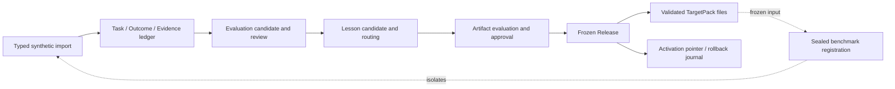

# Architecture

Status: **implemented local MVP foundation; file-only and synthetic-only**

## 1. System shape

The system is an offline, subject-scoped adaptation compiler. It turns explicitly imported,
typed records into review-gated portable artifacts, immutable releases, and inspected target files.
It does not invoke a source or target agent. The Codex and Claude Code renderers only write
external files according to a declared capability profile.



The dotted edge means that a release/pack may be registered for a future experiment only after the
four condition bundles are frozen. Benchmark results never alter that release.

## 2. Records and relationships

`TaskRecord`, `Outcome`, `Evidence`, `EvaluationCase`, `LessonCandidate`, `Artifact`, `Release`,
and `TargetPack` are the canonical top-level records. Their responsibilities are defined in
[`MVP_SPEC.md`](MVP_SPEC.md#2-domain-contract); each has a stable ID, version, canonical digest,
scope, privacy metadata, and exact references.

The accepted lineage is a directed acyclic graph:

```text
TaskRecord --> Outcome --> EvaluationCase
     |             |              |
     +-----------> Evidence --> LessonCandidate --> Artifact --> Release --> TargetPack
```

Evidence may support, contradict, or limit a claim. An `Artifact` retains direct evidence links
even when it also references a lesson. A `Release` holds exact approved artifact versions, while a
`TargetPack` is a derived rendering and never the canonical learned asset.

## 3. Trust, provenance, and privacy controls

The provenance policy treats origin, authority, integrity, verification, partition, scope, and
privacy as different fields. Explicit user feedback can support user intent. Authorized evaluator
results can support their observed outcome. Agent text is a proposal. Tool output, repository
content, webpages, and retrieved material are untrusted context and cannot acquire user-instruction
authority through import or derivation.

Promotion and release validation enforce:

- exact, content-addressed references and canonical serialization;
- evaluation-first progression for correction/failure learning;
- evidence authority and permitted-use checks for the claim type;
- scope, partition, and privacy monotonicity through derivations;
- no construction dependency on held-out records;
- transitive construction timestamps and evaluation attestations no later than the registered
  construction cutoff;
- attributable, non-self approval and policy-version checks;
- closed artifact routing with reviewable escalation rationale; and
- secret-like-content/path scanning during import, rendering, and sanitized export.

Raw payload bytes reside in a separate content-addressed raw store. The metadata ledger and all
pack renderers use minimized promoted records; raw data is neither an artifact body nor target
instruction. Privacy removal/restriction must invalidate dependents for review rather than silently
preserving their verified status.

## 4. Storage and lifecycle

SQLite is a local metadata ledger with checksummed migrations, append-only record/link/lifecycle
and activation journals, rollback-by-default units of work, and subject isolation. A domain-store
adapter reconstructs and validates typed records from the ledger. The raw-evidence store is a
separate local content-addressed namespace.

Content lifecycle and activation are deliberately separate:

| Object | Content lifecycle | Separate operational state |
| --- | --- | --- |
| Evaluation / lesson / artifact | proposed, evaluated, approved or rejected; later superseded/revoked as applicable | none |
| Release candidate / release | draft, evaluated, approved, frozen/released or rejected | immutable membership |
| Target pack | built, validated or rejected | immutable file projection |
| Environment pointer | none | canary, active, superseded, rollback/deactivated events |

Activation validates an approved release/pack relationship and requires a human approval record.
Rollback changes a pointer to an earlier compatible release; it never edits a release, pack, or
artifact.

## 5. Rendering and routing

The portable artifact describes behavioral intent, scope, authority, evidence, privacy constraints,
and evaluation requirements. The renderer is capability-negotiated and fails closed if a target
format cannot preserve a required constraint. Current renderers are:

- `generic-json` and `generic-markdown` for inspection/interchange;
- `codex` for a Codex-oriented external instruction file layout; and
- `claude-code` for a Claude Code-oriented external file layout.

All are deterministic local file emitters. They do not launch either product, install files into a
user configuration, or assert compatibility with a particular agent/model version.

## 6. Repository structure

```text
src/adaptation_compiler_lab/
  domain/           strict records, values, references, enums
  provenance/       lineage, authority, scope/privacy policy
  evaluation/       evaluation-candidate extraction and policy
  routing/          least-invasive route policy
  persistence/      SQLite ledger, migrations, raw store, fixture loading
  application/      import, review, lifecycle, export, targeting adapters
  release/          candidates, gates, freeze and activation services
  targets/          capability profiles and four file renderers
  benchmark/        registration models, manifest, validation
  serialization/    canonical JSON and schema export
  cli.py            Typer command surface
schemas/v1/         generated schemas for the eight top-level records
tests/              unit and synthetic end-to-end coverage
```

## 7. Implementation sequence and next boundary

Completed sequence: contracts and canonical serialization; provenance/routing policies; local
ledger/raw isolation; review/evaluation/release lifecycle; target rendering; benchmark registration;
CLI and synthetic integration tests.

The next authorized work, if explicitly approved, should be a separate design for consented source
capture and an isolated execution/scoring harness. It must first resolve retention, deletion,
authenticated source locators/capture methods, holdout custody and split-manifest binding, target
capability/version pinning, artifact/release withdrawal operations, and human-review operations.
It must not blur the current file-only renderer into a live Codex or Claude Code integration.
