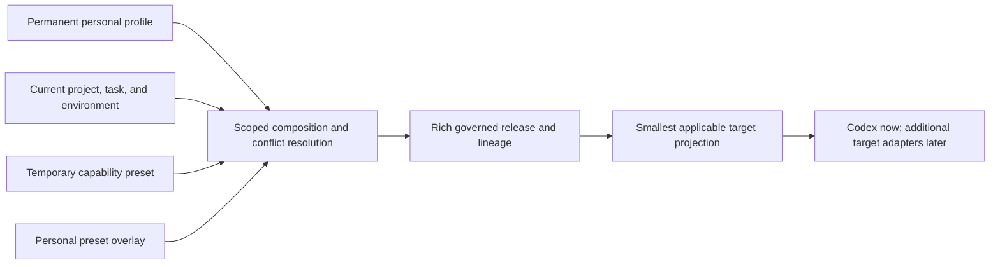
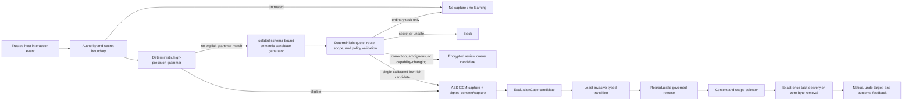
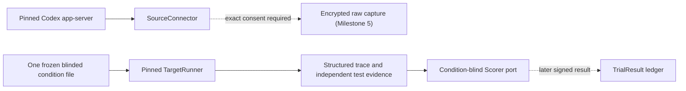

# Architecture

Status: **Milestone 6A.2 product track active; paid external-validation study deferred**

## 1. System shape

The core system is a subject-scoped adaptation compiler. It turns explicitly imported typed
records into review-gated portable artifacts, immutable releases, and inspected target files.
Milestone 4 adds narrow source/runner ports around that core; it does not turn the compiler into a
general agent host. Codex and Claude Code renderers still only write external files, while the new
runtime adapters are separately pinned and fail closed.

```mermaid
flowchart LR
    K["External Ed25519 and AES keys"] --> G["Signed governance ledger"]
    G --> I["Typed synthetic import"]
    I --> R["Task / Outcome / Evidence ledger"]
    R --> E["Evaluation candidate and review"]
    E --> L["Lesson candidate and routing"]
    L --> A["Artifact evaluation and approval"]
    A --> F["Frozen Release"]
    F --> P["Validated TargetPack files"]
    F --> X["Activation pointer / rollback journal"]
    P --> L6["Longitudinal scope and supersession resolver"]
    L6 --> DF["Fresh Codex dogfood delivery"]
    DF --> FB["Append-only helped / hurt / irrelevant feedback"]
    FB --> MX["Activation, correction, size, latency, effort metrics"]
    G --> C["Signed impact preview and recall"]
    C --> R
    C --> F
    C --> P
    C --> X
    H["External encrypted held-out bundle"] --> B["Signed custody manifest"]
    B --> Q["Signed benchmark registration"]
    P -. frozen condition input .-> M["Atomic four-material freeze"]
    Q --> M
    M --> D["Signed allow / deny access chain"]
    D -. later milestone only .-> T["Blinded immutable trial results"]
    T --> J["Digest-only adjudication chain"]
    B -. blind IDs, strata, digest only .-> I
```



The dotted edges mark deliberately constrained information flow. Construction receives only
payload-free blinded split metadata, and the dormant trial-result path cannot retrieve held-out
plaintext. Benchmark results and adjudications never alter the release they evaluate.

### 1.1 Product runtime composition

The product runtime composes three first-class inputs while keeping their ownership separate:



Explicit current user instructions and applicable project policy remain outside the adaptation
asset and outrank it at use time. Permanent learning never silently absorbs a preset. A preset and
its overlay require an exact source/version binding and explicit temporary activation; those
operations remain reserved for Milestone 6B.

The Milestone 6A.2 runtime core adds this automatic local flow:



The standing policy is a signed target, not an instruction source. It authorizes only bounded
memory, preference, example, procedure, and prompt-rule routes. Skills, tools, plugins, MCP,
network/credential changes, adapters, and capability presets cannot be auto-created through this
path. The runtime issues task-exact consent and capture receipts, stores raw text only in the
encrypted raw store, and persists raw-free state/cycle/review/event/feedback rows with append-only
triggers and compare-and-swap state heads.

The generic host coordinator polls replayable typed pages and atomically appends state, cycle,
raw-free review work, and signed runtime actions before dispatching idempotent delivery, review,
and notice sinks. Milestone 6A.2B adds a concrete Codex host that keeps post-task learning separate
from later task activation. Its hashed prefix cursor commits after notice/review acknowledgement,
and a replay after interruption reproduces the exact historical learning result. Local
notice/review/undo/feedback commands are implemented. Milestone 6A.2D adds a renewable single-owner
watcher lease, jittered retry, raw-free durable inbox, and generic Windows toasts. The watcher is
installed only by an explicit same-user command and semantic serving remains review-only.

The semantic detector is an optional interpretation port, not a replacement trust boundary.
`grammar`, `shadow`, `review`, and `calibrated` modes are explicit. One fresh ephemeral Codex
session receives only the ordered authoritative user-message batch in an empty network-denied
read-only workspace and must return a strict schema with exact supporting quotes. Tool use,
ambient instructions, model rerouting, malformed output, missing observations, or interpreter
failure aborts the whole page before state or cursor writes. Deterministic code still controls
origin, secrets, route coherence, registered scope, standing policy, review, promotion,
supersession, revocation, and release construction. See `SEMANTIC_FEEDBACK_DETECTOR.md`.

Milestone 6A.2C separates the source execution surface from the target surface at configuration
time. One governed project has a canonical target root plus explicit source-CWD aliases; source
and target may carry different executable, saved-auth-home, runtime-lock, and Windows-interoperability
settings. This permits native Windows Codex Desktop history to map to a canonical WSL repository
without inferring either path from unrelated ambient state.

Each post-task learning cycle may receive exactly one append-only `RuntimeLearningAssessment`,
bound to the cycle digest and classified as correct, false-positive, or missed. A typed
`CodexDogfoodGateReport` combines those assessments with exact activations, acknowledgements,
relevance feedback, pack bytes, latency, and maintenance counts. It reports evidence readiness
without promoting learning or deciding product success.

The dogfood integration has a second, non-benchmark target boundary:

```mermaid
flowchart LR
    C1["Completed interactive Codex user message"] --> P["Pinned list/read + cutoff + path allowlist"]
    P --> L1["Learning-only receipt and governed release"]
    L1 --> A1["Later signed task activation"]
    A1 --> H["Fresh auth-only Codex home"]
    H --> T1["One exact task projection"]
    T1 --> K["Completed/failed delivery acknowledgement"]
    K --> F1["Helped / hurt / irrelevant feedback"]
```



Milestone 6A.2D adds a writable gateway after activation:

```mermaid
flowchart LR
    A["Frozen release + compact projection"] --> W["Exact detached writable worktree"]
    W --> C["Fresh auth-only multi-turn Codex session"]
    C --> B["Encrypted complete change bundle"]
    B --> V["Second clean worktree + protected independent tests"]
    V --> R["Local diff review"]
    R -->|explicit apply| G["Unchanged canonical Git tree"]
    G --> T["Independent post-apply tests"]
    T -->|failure| X["Automatic byte-and-mode rollback"]
```



The rich release, session transcript, and code bytes stay outside target-visible material. Each
gateway session freezes one release generation and never hot-reloads learning. Windows target
execution requires a local `/mnt/<drive>` worktree and rejects the safe read-only downgrade used
by the older UNC inspection path. Verification commands are configuration-bound argv arrays;
their trusted inputs are protected from agent edits and rerun in a separate clean worktree.
Canonical application requires an exact expected HEAD, clean status, matching before digests and
modes, a valid encrypted bundle, and all-or-nothing rollback. It never commits or pushes.

The runtime boundary is deliberately outside promotion and custody:



The Codex connector has also passed a metadata-only real inventory through a separately pinned
Desktop runtime; previews and raw paths were omitted. The Claude runner passed one accepted
authenticated synthetic smoke against the pinned model and sandbox. `source inventory|capture` is
the only source CLI surface. Capture cannot reach `thread/read` before exact signed consent,
signer/time/use checks, and an external AES key pass. The complete held-out/condition bundle is
sealed and verified; its first retrieval into a disposable trial coordinator remains unreachable
until an allowed custody reveal and explicit paid-run authorization.

## 2. Records and relationships

`TaskRecord`, `Outcome`, `Evidence`, `EvaluationCase`, `LessonCandidate`, `Artifact`, `Release`,
and `TargetPack` are the canonical top-level records. Their responsibilities are defined in
[`MVP_SPEC.md`](MVP_SPEC.md#2-domain-contract); each has a stable ID, version, canonical digest,
scope, privacy metadata, and exact references.

The accepted lineage is a directed acyclic graph:

```text
TaskRecord --> Outcome --> EvaluationCase
     |             |              |
     +-----------> Evidence --> LessonCandidate --> Artifact --> Release --> TargetPack
```

Evidence may support, contradict, or limit a claim. An `Artifact` retains direct evidence links
even when it also references a lesson. A `Release` holds exact approved artifact versions, while a
`TargetPack` is a derived rendering and never the canonical learned asset.

Fourteen signed governance objects sit beside, rather than inside, the eight-record portable
contract. The first eight govern identity, evidence admission, lifecycle, and recall:

| Object | Responsibility | Binding |
| --- | --- | --- |
| `SignerIdentity` | Self-signed public identity and role/validity declaration for one dedicated Ed25519 key. | Subject, raw public key, fingerprint, roles, creation/expiry, signature. |
| `ConsentReceipt` | Permission boundary for a selected source. | Subject, exact selector, scope, uses, expiry, retention, policy, signer/signature. |
| `CaptureReceipt` | Capture or synthetic-preview attestation. | Exact consent digest, selector, source/schema digest, payload digest, time, signer/signature. |
| `GovernanceEvent` | Uniform signed review, release, activation, or custody action. | Exact target reference/digest, decision, reason, policy, time, role, signature. |
| `DependencyImpact` | Confirmation-bound snapshot computed before invalidation. | Exact root, requested action, complete affected set, lifecycle/activation heads, payload metadata, graph digest, policy, signer/signature. |
| `InvalidationEvent` | Append-only declaration that an exact target is no longer eligible. | Exact target/digest, action, impact reference, reason, effective time, policy, signer/signature. |
| `TombstoneReceipt` | Minimal proof that selected encrypted payload bytes were unlinked. | Payload digest/size/media type, exact Evidence and invalidation refs, deletion method/time, signer/signature; never payload content. |
| `RecallReport` | Idempotent completion record for one confirmed impact. | Exact impact, invalidations, tombstones, deactivated environments, purged digests, policy, signer/signature. |

Milestone 3 adds six benchmark-specific objects:

| Object | Responsibility | Binding |
| --- | --- | --- |
| `CustodyManifest` | Proves which encrypted external bundle contains the held-out split without recording its path. | Four blinded task descriptors, split digest, ciphertext digest, authenticated plaintext digest/length, algorithm, policy, signer/signature. |
| `BenchmarkRegistration` | Freezes the feasibility design before source construction. | Exact custody ref, design digest, opaque condition IDs, cutoff/start/reveal boundaries, committed randomization seed, signer/signature. |
| `ConditionMaterialReceipt` | Freezes one condition's actual target-visible material and construction method. | Exact registration, blind condition ID, wrapper/material/bundle/corpus digests, sources, actual token/byte counts, author constraints, signer/signature. |
| `TrialResult` | Stores one immutable blinded evaluation row. | Exact registration/material refs, blind task/condition/repetition, trial/environment/rubric/test digests, 60/25/15 component scores, validity and guardrails, signer/signature. |
| `AdjudicationRecord` | Corrects or excludes a stored result without rewriting it. | Exact result ref, sequence and prior adjudication, decision, digest-only field changes, reviewer, signer/signature. |
| `CustodyAccessEvent` | Makes seal verification and reveal authorization auditable. | Exact custody/registration refs, chained sequence/prior ref, action, allowed/denied outcome, actor, reason, signer/signature. |

Evidence v1.0 remains immutable and readable. Evidence v1.1 adds exact consent and capture refs.
For non-synthetic evidence the admission policy resolves both signed objects and checks subject,
scope, permitted uses, expiry, retention, selector, and payload digest. Synthetic v1.1 evidence
cannot borrow real receipts.

Single-evidence and single-artifact derivatives retain one exact consent basis. A `TargetPack` is
the one permitted multi-consent aggregation boundary: its privacy context must equal the canonical
sorted union of the exact consent bases carried by every release artifact. It cannot invent,
collapse, omit, or broaden a basis, and ordinary derivative validation remains strict.

## 3. Trust, provenance, and privacy controls

The provenance policy treats origin, authority, integrity, verification, partition, scope, and
privacy as different fields. Explicit user feedback can support user intent. Authorized evaluator
results can support their observed outcome. Agent text is a proposal. Tool output, repository
content, webpages, and retrieved material are untrusted context and cannot acquire user-instruction
authority through import or derivation.

Promotion and release validation enforce:

- exact, content-addressed references and canonical serialization;
- evaluation-first progression for correction/failure learning;
- evidence authority and permitted-use checks for the claim type;
- scope, partition, and privacy monotonicity through derivations;
- no construction dependency on held-out records;
- transitive source timestamps and evaluation attestations no later than the registered
  source-eligibility cutoff;
- release and condition construction no earlier than their separately registered construction
  boundary—the historical eligibility cutoff is never reused as a release-freeze timestamp;
- attributable, non-self approval and policy-version checks;
- closed artifact routing with reviewable escalation rationale; and
- secret-like-content/path scanning during import, rendering, and sanitized export.

Source raw payload bytes reside in a separate AES-256-GCM content-addressed raw store. The address is the
plaintext SHA-256; ciphertext uses a fresh 96-bit nonce and authenticates digest, media type, and
plaintext size. The 32-byte AES key and encrypted Ed25519 private key are separate and external to
the workspace/repository. Missing key, wrong fingerprint, malformed envelope, or failed tag
verification stops access. The metadata ledger and all pack renderers use minimized promoted
records; raw data is neither an artifact body nor target instruction. Restriction or withdrawal
marks every transitive dependency unusable, revokes artifacts, retires releases, invalidates packs,
and deactivates affected active pointers. Purge additionally deletes selected encrypted bytes and
retains only signed minimal tombstones and immutable metadata.

Held-out benchmark bytes use a third, separately selected 32-byte key and a distinct custody store
that refuses any location inside the compiler workspace or any Git repository. Its randomized
AES-256-GCM envelope authenticates the benchmark ID, blinded split digest, plaintext digest/length,
and key fingerprint. A separate mode-0600 seed deterministically derives opaque task/family/
condition IDs and the 32-cell order; construction receives only its commitment. The final sealed
bundle contains hidden tasks, mapping, order, and exact frozen materials, while the signed custody
manifest intentionally contains no filesystem locator. Verification authenticates the seal but
returns metadata only; every seal, verification, or reveal request extends a signed hash-linked
access chain.

Runtime identity is a fourth, public-integrity boundary. The packaged lock contains package
integrity values, executable SHA-256 digests, exact version output, a canonical digest of Codex's
complete generated schema bundle, selected schema snapshots, Claude's fixed full model ID, and
sandbox-helper identities. It contains no executable path or credential. Every source connection
regenerates and rechecks Codex schemas; every target run rechecks Claude and sandbox binaries.

Claude execution uses a fresh configuration directory, bare mode, no session persistence, no
ambient setting sources, one digest-verified condition file, stdin task delivery, and a fixed
structured-output command. Only `Read`, `Glob`, `Grep`, `Edit`, `Write`, and Bash are visible as
data/action tools, and only manifest-approved Bash patterns are preapproved. The documented
non-removable `EndConversation` control may terminate a run. `dontAsk` denies everything else.
MCP, Agent, web, plugin, skill, workflow, memory, background tasks, updates, telemetry, and
alternate providers are disabled. Bubblewrap must start successfully; unsandboxed fallback and
Bash network access are disabled. The trace's model/tool/MCP/plugin inventory and every tool use
are checked before a result is accepted.

## 4. Storage and lifecycle

SQLite is a local metadata ledger with checksummed migrations, append-only record/link/lifecycle,
activation, benchmark, and signed-governance journals, rollback-by-default units of work, and subject
isolation. The governance store verifies canonical bytes, digest, signature, signer role, and
subject on both write and read. A domain-store adapter reconstructs and validates typed records
from the ledger. The encrypted raw-evidence store remains a separate namespace.

Content lifecycle and activation are deliberately separate:

| Object | Content lifecycle | Separate operational state |
| --- | --- | --- |
| Evidence / evaluation / lesson | raw/derived or proposed/reviewed; later restricted, purged, or excluded by lifecycle overlay | raw bytes remain separate and may be deleted only by confirmed purge |
| Artifact | proposed, evaluated, approved or rejected; later superseded/revoked | none |
| Release candidate / release | draft, evaluated, approved, frozen/released or rejected; later retired | immutable membership |
| Target pack | built, validated or rejected; later invalidated | immutable file projection |
| Environment pointer | none | canary, active, superseded, rollback/deactivated events |

Activation validates an approved release/pack relationship and requires a human approval record.
Rollback changes a pointer to an earlier compatible release; it never edits a release, pack, or
artifact.

Recall is a two-step operation. `recall preflight` computes the transitive incoming-reference
closure, captures lifecycle and activation heads, signs it, and returns its canonical digest.
`recall execute` requires that exact digest, recomputes the graph inside a write transaction, and
refuses stale previews. Lifecycle invalidations and every affected active-pointer deactivation
commit atomically. For purge, ciphertext is authenticated before deletion; if the SQLite
transaction fails, bytes are restored under the same content address before the error is returned.
An exact completed impact is idempotent, while reusing an impact ID for different content fails.

Conflict resolution is a pure closed policy: exclude revoked/expired material; prefer a strictly
narrower applicable scope; at equal scope prefer a later explicit user correction; then compare
claim-specific authority using `user_normative > authorized_evaluator > project_policy >
observational > proposal_only > untrusted_context > synthetic_only`; otherwise return unresolved
and block release. The resolver returns the winner, loser, resolution class, and rationale, and
release gates compare declared resolutions to that computed result.

## 5. Rendering and routing

The portable artifact describes behavioral intent, scope, authority, evidence, privacy constraints,
and evaluation requirements. The renderer is capability-negotiated and fails closed if a target
format cannot preserve a required constraint. Current renderers are:

- `generic-json` and `generic-markdown` for inspection/interchange;
- `codex` for a Codex-oriented external instruction file layout; and
- `claude-code` for a Claude Code-oriented external file layout.

All four remain deterministic local file emitters. They do not launch either product or install
files into user configuration. The separate Claude runner may inject a rendered, frozen condition
file for a controlled study run only; that does not make a renderer an integration.

For the pilot, the provenance-rich `TargetPack` remains the portable audit projection. The compiled
benchmark condition is a deterministic budgeted behavioral projection of all eight approved
contracts. It omits target-irrelevant provenance prose but stays bound to the exact release,
TargetPack, artifact set, corpus, wrapper, and frozen condition digests.

## 6. Repository structure

```text
src/adaptation_compiler_lab/
  domain/           strict records, values, references, enums
  governance/       signed identity/receipt/event contracts and Ed25519 custody
  conflicts/        deterministic scoped conflict precedence
  automatic_runtime/ governed detector/compiler/service, Codex dogfood host, replay, metrics
  recall/           dependency impact analysis and confirmed recall execution
  provenance/       lineage, authority, scope/privacy policy
  evaluation/       evaluation-candidate extraction and policy
  routing/          least-invasive route policy
  persistence/      SQLite ledger, migrations, raw store, fixture loading
  application/      import, review, lifecycle, export, targeting adapters
  release/          candidates, gates, freeze and activation services
  targets/          capability profiles and four file renderers
  benchmark/        designs, isolated role packets, software custody, scoring, validation
  connectors/       ports, runtime pins, Codex schema snapshots and source adapter
  runners/          isolated pinned Claude Code execution
  serialization/    canonical JSON and schema export
  cli.py            Typer command surface
schemas/v1/         immutable schemas for the eight v1.0 records
schemas/v1_1/       additive Evidence v1.1 schema snapshot
schemas/governance/v1/ signed governance schema snapshots
preregistration/    frozen machine-readable feasibility design and byte-digest sidecar
conformance/        sanitized runtime-conformance status; never raw traces
tests/              unit and synthetic end-to-end coverage
```

## 7. Implementation sequence and next boundary

Completed sequence through Milestone 3: contracts and canonical serialization; provenance/routing
policies; review/evaluation/release lifecycle; target rendering; Ed25519 governance; AES raw
isolation; v1.1 evidence lineage; signed withdrawal objects; dependency preflight; recall/purge
cascades; deterministic conflict resolution; signed benchmark custody/registration/material/result
objects; encrypted external bundle binding; append-only access/adjudication; preregistration freeze;
and synthetic security tests.

Milestone 4 adds the explicit ports, fake fixtures, binary and generated-schema
drift checks, read-only Codex app-server adapter, fixed-model Claude runner, clean configuration,
hard sandbox, tool/network denials, structured trace validation, timeout, and teardown. The pinned
Codex empty-home handshake and the authenticated no-user-data Claude smoke pass. The accepted smoke
cost USD $0.01566765, captured only allowed `Read` and `Edit` uses, persisted no raw trace, and
destroyed its synthetic workspace.

Milestone 5 uses a separate immutable lock for the Desktop-bundled Codex
`0.145.0-alpha.30` executable because its state and generated response schemas differ from the npm
CLI despite sharing the 0.145 line. The adapter converts only resolved `/mnt/<drive>` paths,
regenerates and hashes the complete schema tree, and then performs app-server calls. The first
real call listed 11 completed task metadata records with no next page.

`SourceCaptureService` checks one exact selector, the frozen pilot use set, validity/retention,
identity role/fingerprint, unused receipt ID, and AES-GCM availability before `thread/read`. It
stores only ciphertext and appends a signed capture receipt. A review projection labels user
messages as eligible user authority and agent/tool/system channels as untrusted; it does not infer
outcomes or lessons.

Automatic continuation still does not weaken objective gates. The internal v1.1 design replaces
external staffing with functional separation: two fresh AI contexts construct/review the strong
profile from digest-bound packets; a separate software-custody context owns held-out plaintext,
condition mapping, and the committed randomization seed; construction sees commitments only; and
Kevin receives randomized, condition-free scoring packets. The custody registry and keys remain
outside the compiler workspace. The four materials and complete custody bundle are now frozen;
real target trials require explicit paid-run authorization.

The 6A.2 product track adds a signed standing-policy runtime, deterministic feedback detector,
encrypted task-exact capture, evaluation-first automatic promotion, arbitrary sequential
scope/supersession/revocation compilation, compact Codex delivery, and longitudinal feedback.
Milestone 6A.2B adds pinned Linux/Windows Codex pickup, hashed durable checkpoints, separate later
activation and delivery acknowledgement, and local notice/review/undo/feedback commands.
Milestone 6A.2D adds explicit same-user background startup and a persistent multi-turn writable
gateway without injecting into unsupported ordinary Desktop sessions. It is ambient pickup with a
governed session entrypoint, not an unrestricted operating-system-wide memory hook.
