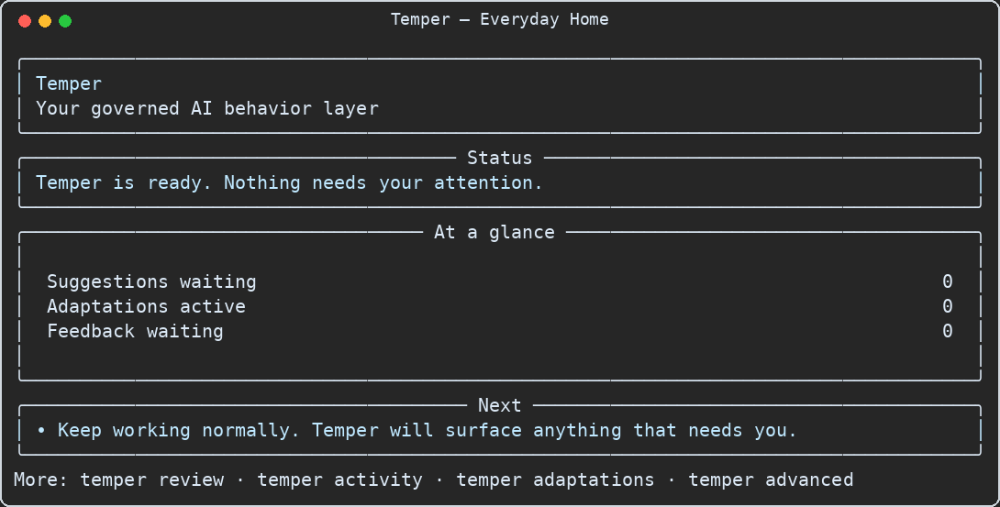

# Temper Terminal UI Gallery

These images are deterministic captures of the implemented `temper` terminal renderer. They are
not design mockups or AI-generated approximations.

The advanced dashboard and gate reflect the raw-free cumulative development ledger at the
2026-08-22 checkpoint. The everyday home, review, active-adaptation, and phone views use clearly
labeled synthetic data so each interaction state is visible. No raw evidence, credential, private
filesystem path, or sealed-study content appears in these images.

## Everyday home

This is the default. It answers whether Temper is working, whether it needs attention, and what to
do next without exposing research or governance internals.

## Advanced operator dashboard

The previous dense view remains available with `temper advanced` for development, support, and
research inspection.

## Current longitudinal gate

## Review inbox example

## Active adaptation example

## Phone and Codex Remote output

