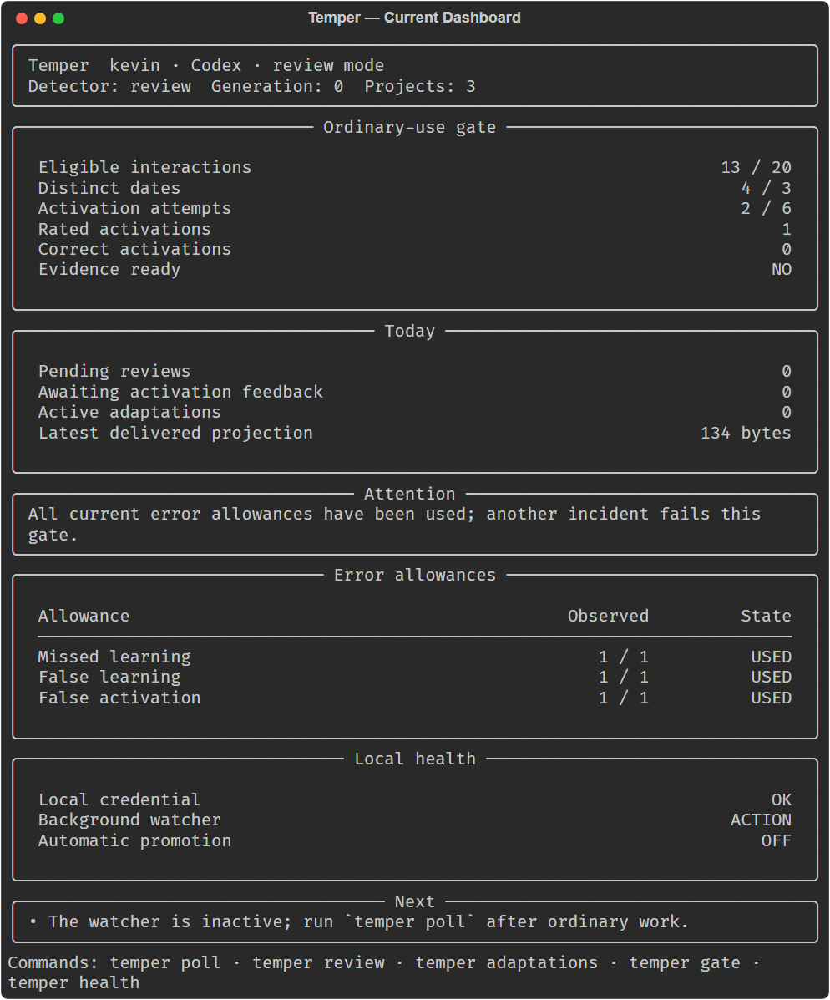
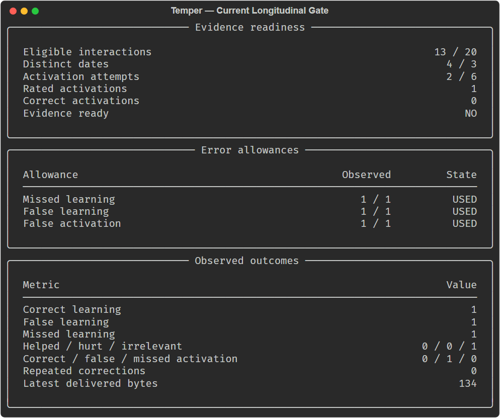
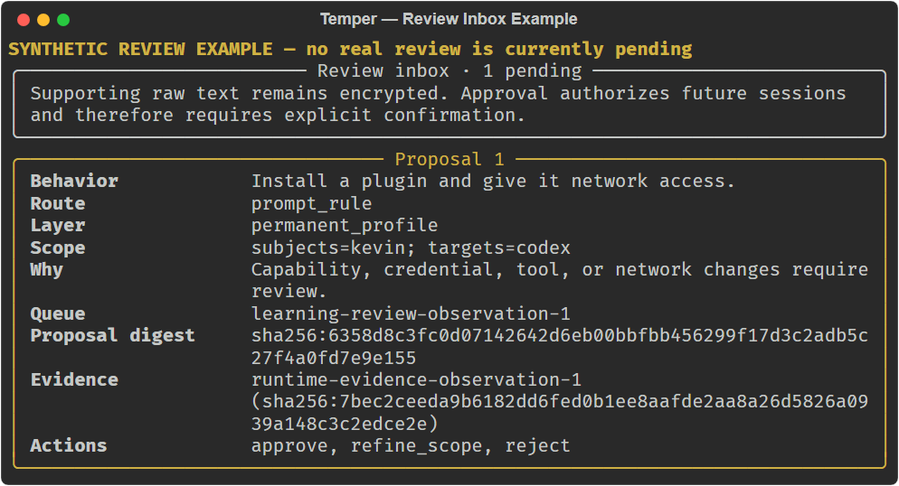
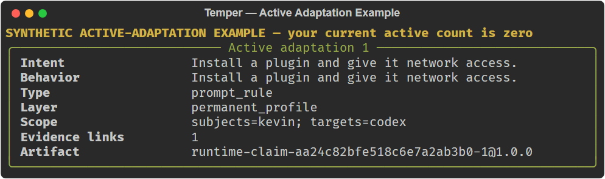
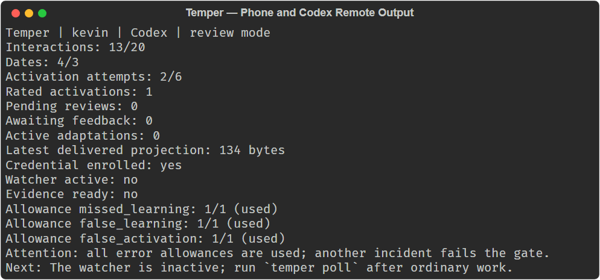

# Temper Terminal UI Gallery

These images are deterministic captures of the implemented `temper` terminal renderer. They are
not design mockups or AI-generated approximations.

The dashboard, gate, and phone views reflect the raw-free cumulative development ledger at the
2026-08-22 checkpoint. The review and active-adaptation views use clearly labeled synthetic data
because that ledger had no pending review and no active adaptation. No raw evidence, credential,
private filesystem path, or sealed-study content appears in these images.

## Current dashboard

## Current longitudinal gate

## Review inbox example

## Active adaptation example

## Phone and Codex Remote output

