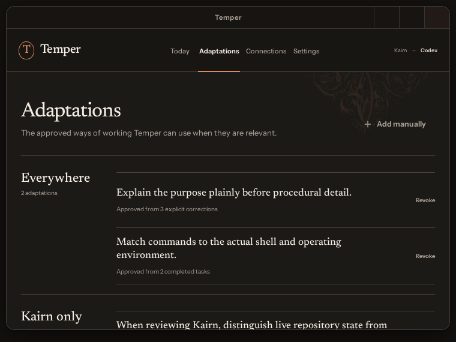

# Temper React desktop visual gallery

These images are deterministic Playwright baselines rendered from synthetic, raw-free data. They
are the visual approval gate before the React surface is connected to the governed Python engine.
The defining surfaces use the **Quiet Folio** direction: restrained editorial typography, one
continuous page, one current statement, a focused suggestion, plain scope/source/status context,
and readable approved adaptations. Persistent security badges, numbered navigation, proposal IDs,
maker stamps, and the full runtime projection register are intentionally absent from the everyday
surface. A professionally drawn CC0 antique acanthus corner grows asymmetrically from an outer edge
instead of framing conventional cards. Exact asset provenance, font licenses, and sanitized vector
digests are recorded in
[third-party notices](../THIRD_PARTY_NOTICES.md).

## Everyday Today surface

## Focused suggestion review

## Approved adaptations

## Agent and project connections

## Settings and exact privacy controls

## Onboarding

## Tray and notification behavior

## Advanced task lab

## Compact desktop window

Approval should evaluate whether the product now reads as a personal governed behavioral document
rather than a generic B2B dashboard; the calmness of Today; the hierarchy of the review sheet; the
legibility of behavioral clauses; and whether the botanical detail feels distinctive without
becoming ornamental noise.
Approval does not authorize a particular implementation of engine IPC or agent hooks; those retain
their independent security and conformance gates.
