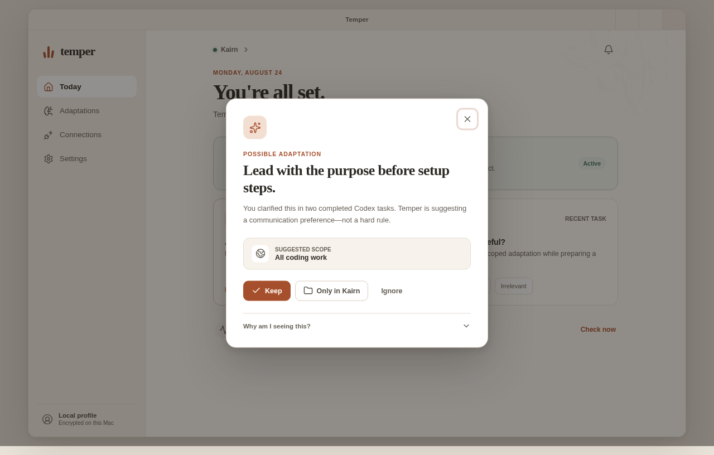
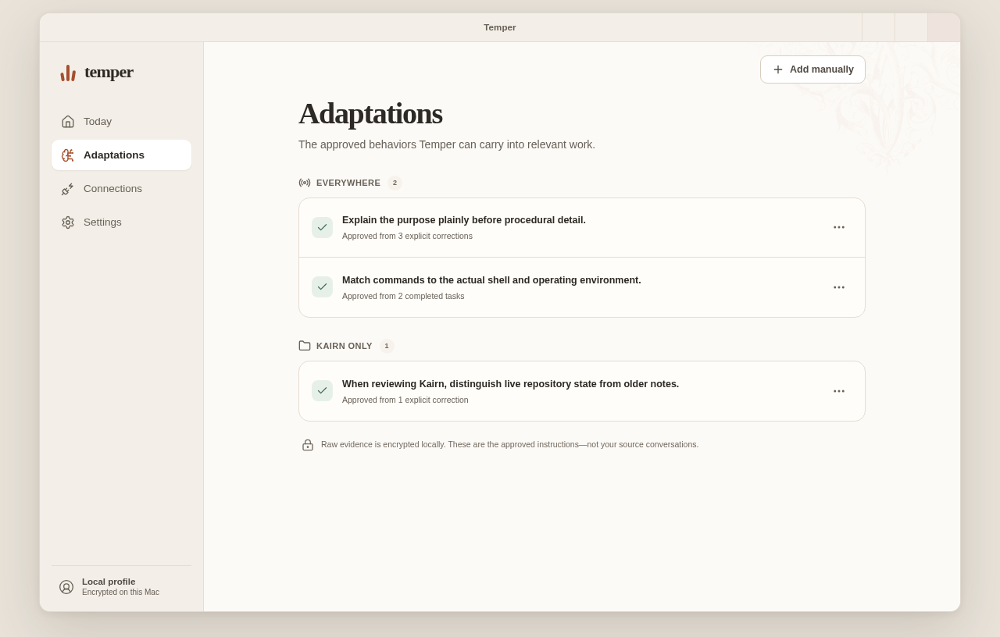
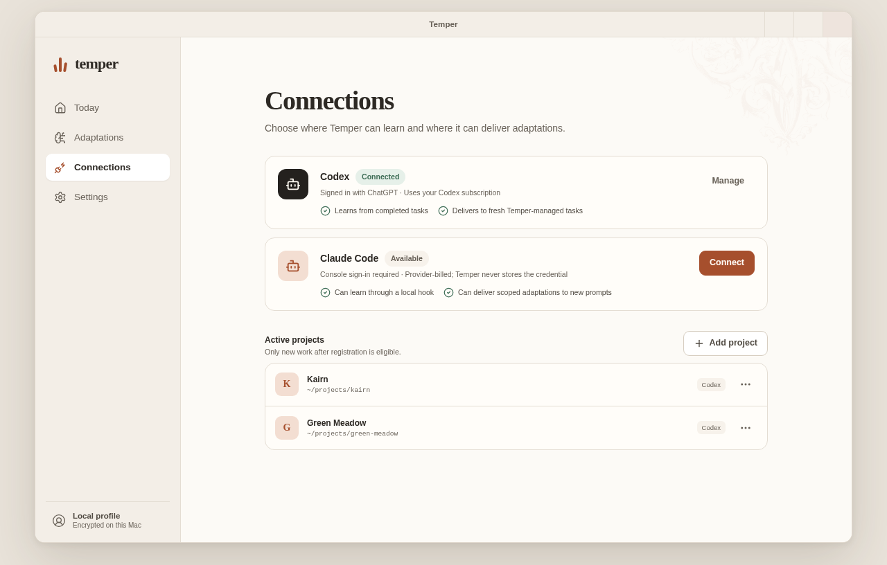
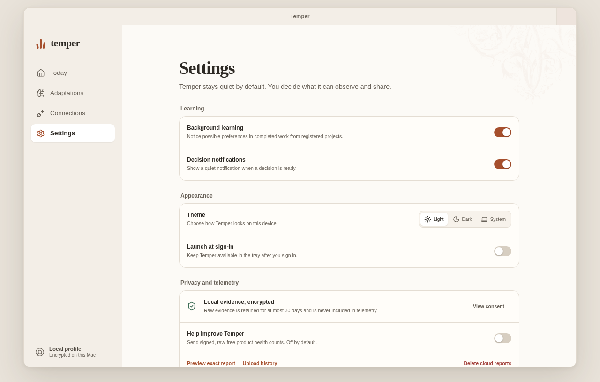
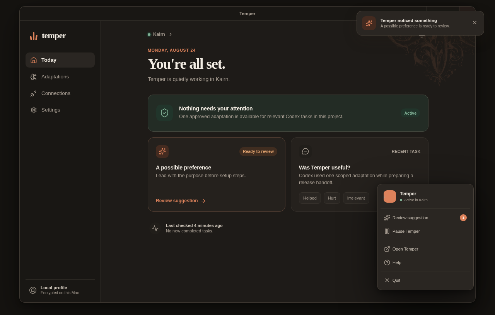
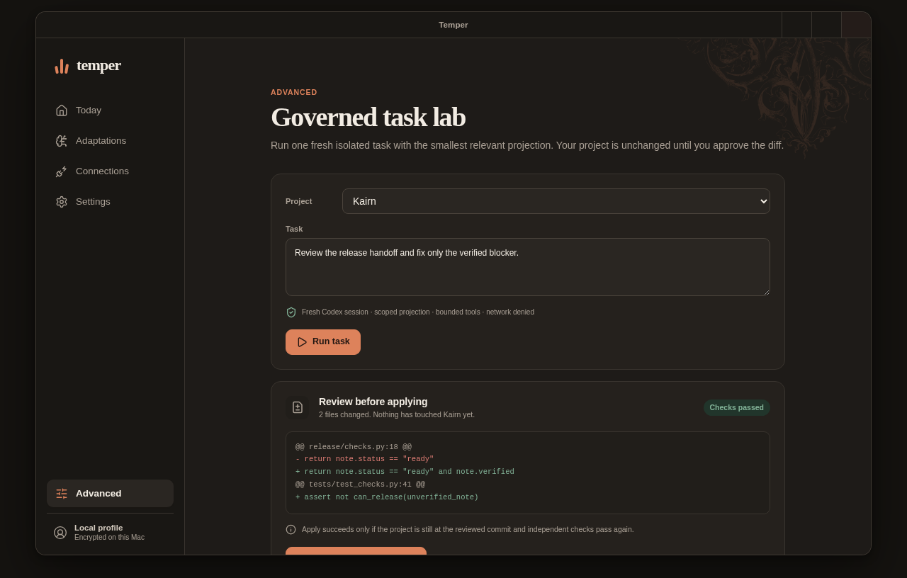

# Temper React desktop visual gallery

These images are deterministic Playwright baselines rendered from synthetic, raw-free data. They
are the visual approval gate before the React surface is connected to the governed Python engine.
The dark surfaces include a professionally drawn CC0 antique acanthus corner. Temper crops and
mirrors its irregular scrollwork at opposite window edges instead of drawing a rectangular frame,
then recolors it as a deliberately faint, noninteractive copper identity layer. Its exact
provenance, upstream digest, and sanitized vendored digest are recorded in
[third-party notices](../THIRD_PARTY_NOTICES.md).

## Everyday Today surface

## Focused suggestion review

## Approved adaptations

## Agent and project connections

## Settings and exact privacy controls

## Onboarding

## Tray and notification behavior

## Advanced task lab

## Compact desktop window

Approval should evaluate the calmness of the default surface, hierarchy of the review sheet,
legibility, product voice, color direction, whether the botanical detail feels distinctive without
becoming ornamental noise, and whether diagnostic detail is sufficiently hidden.
Approval does not authorize a particular implementation of engine IPC or agent hooks; those retain
their independent security and conformance gates.
